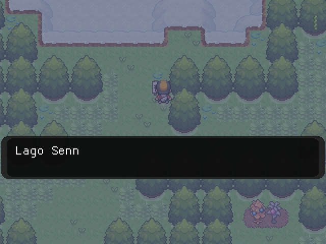

# Pokémon Reloaded para R36S / ArkOS

Port nativo de **Pokémon Reloaded The Last Beta 1.9.2.2** para la **R36S** y otros handhelds
ARM64 con ArkOS, usando [OpenGMK](https://github.com/OpenGMK/OpenGMK). No usa Wine ni un Windows
emulado: ejecuta el `reloaded.exe` original sobre un motor nativo en Rust y SDL2/KMSDRM.



Probado en una R36S con ArkOS 09292023, OpenGL ES 3.2 (Mali-G31) y pantalla de 640x480.

Esta es la build **centrada** (`gm8emulator_centered`), elegida por estabilidad. En algunos combates
el borde derecho puede quedar recortado y el nivel del rival puede no verse completo; es la build
que mejor funciona por ahora. El fallo está documentado abajo.

## Créditos

- **Juego original:** [F3R Productions / F3R](https://pokemon-reloaded.blogspot.com/), autor de
  Pokémon Reloaded. Todos los derechos del juego y sus assets son suyos. Este repositorio **no
  incluye** el juego ni sus datos.
- **Port a Android y trabajo sobre OpenGMK:** [Klisee](https://github.com/Klisee/pokemon-reloaded-android),
  publicado bajo GPL-2.0. Su port es la base del motor usado aquí.
- **OpenGMK:** [OpenGMK/OpenGMK](https://github.com/OpenGMK/OpenGMK), reimplementación nativa del
  motor de Game Maker 8.
- **Agradecimiento adicional:** Alexpix0 (Armando), por el diagnóstico y las pruebas de las
  correcciones de GPU en el port de Android.
- **Empaquetado para R36S/ArkOS:** Kuranesx.

## Qué incluye este port

- `pokemonreloaded/gm8emulator`: motor OpenGMK compilado para `aarch64` (build centrada,
  md5 `a4a026902dfc4f4584670759791d73c9`).
- `pokemonreloaded/assets`: recursos propios de OpenGMK (no son assets del juego).
- `pokemonreloaded/gamecontrollerdb.txt`: mapeo del mando de la R36S.
- Scripts de arranque, backups de partidas y licencias.

**No incluye** `data/` ni el `.exe` del juego. Hay que descargar el juego original desde el blog
de F3R. Esto mantiene el repositorio dentro de los términos del autor y evita subir 4 GB de assets
a GitHub.

## Instalación sencilla

### 1. Descargar el port

Descarga `pokemonreloaded.zip` desde la sección **Releases** de este repositorio.

### 2. Copiar el port a la consola

Descomprime el zip dentro de la carpeta de ports de tu sistema:

- ArkOS en esta R36S: `/roms2/ports/`
- ArkOS/AmberELEC con una sola tarjeta: `/roms/ports/`

Debe quedar así:

```text
/roms2/ports/
├── Pokemon Reloaded.sh
└── pokemonreloaded/
    ├── gm8emulator
    ├── run.sh
    ├── assets/
    └── ...
```

### 3. Descargar el juego original

Ve a la entrada oficial de **The Last Beta 1.9.2**:

<https://pokemon-reloaded.blogspot.com/2026/08/the-last-beta-192.html>

Descarga `Proyecto Reloaded The Last Beta 1.9.2.2 Full.zip` desde los enlaces del blog (Mega o
Gofile). Los enlaces directos pueden cambiar; usa siempre la entrada oficial.

### 4. Copiar los datos del juego

Descomprime el zip oficial y copia **el contenido** dentro de `pokemonreloaded/`, junto a
`gm8emulator`:

```text
/roms2/ports/pokemonreloaded/
├── gm8emulator
├── Proyecto Reloaded The Last Beta 1.9.2.2 Full.exe
├── data/
│   ├── audio/
│   ├── partidas/
│   └── ...
└── ...
```

No hace falta renombrar el `.exe`: `run.sh` detecta el primer `.exe` de la carpeta. Asegúrate de
que `data/` esté al mismo nivel que `gm8emulator`.

### 5. Jugar

En ArkOS, abre **Ports** y entra en **Pokémon Reloaded**. La primera vez puede tardar unos segundos
mientras el motor prepara sus recursos.

Si lo lanzas desde una terminal:

```bash
cd /roms2/ports
./"Pokemon Reloaded.sh"
```

## Instalación con un agente de IA

Copia este bloque en tu agente (OpenCode, Claude Code, Codex, etc.) y dale la ruta del zip oficial
del juego:

```text
Instala Pokémon Reloaded R36S desde este repositorio:
https://github.com/Kuranesx/pokemon-reloaded-r36s

La consola está en <IP>, usuario ark, con la clave SSH que ya tengo configurada.
1. Clona este repositorio o descarga el release pokemonreloaded.zip y descomprímelo
   en /roms2/ports/.
2. Usa el zip oficial de Pokémon Reloaded 1.9.2.2 que te indico.
3. Desde el repositorio, ejecuta bash tools/install-game.sh para copiar data/ y el
   .exe dentro de /roms2/ports/pokemonreloaded/.
4. Verifica que data/ y el .exe estén junto a gm8emulator; no borres assets/ ni los scripts.
5. Da permisos de ejecución a gm8emulator y a los .sh.
6. Si hay un servidor X/GDM activo, deténlo antes de lanzar el juego KMSDRM.
7. Lanza /roms2/ports/Pokemon\ Reloaded.sh y revisa /roms2/ports/pokemonreloaded/log.txt.
No subas data/ ni el .exe a GitHub: son del autor original.
```

El instalador también se puede usar a mano:

```bash
bash tools/install-game.sh "/ruta/Proyecto Reloaded The Last Beta 1.9.2.2 Full.zip" \
  /roms2/ports/pokemonreloaded
```

## Controles

El juego lee el mando por SDL. En la R36S se usa el mapeo de `gamecontrollerdb.txt`; los botones
principales funcionan como A/B/X/Y, la cruceta y el stick izquierdo para mover, y Start/Select para
los menús. Si tu mando no responde, revisa que esté en modo mando y no en modo teclado.

## Guardado y backups

Las partidas viven en `data/partidas/`. El port hace una copia antes y después de cada sesión en:

```text
pokemonreloaded/saves-backup/<fecha-hora>/partidas/
```

También puedes cambiar el destino con `GM8_SAVE_BACKUP_DIR`.

## Problema conocido de esta build

En la build centrada, algunos elementos del borde derecho de la interfaz de combate quedan
recortados; en particular, el **nivel del Pokémon rival** puede no verse completo. La build
`rightalign` posterior no se publica porque la build centrada es la que mejor se comporta en
general. Si quieres ayudar a corregirlo, el código y las instrucciones de compilación están en
`source/`.

## PortMaster

El paquete sigue el formato de PortMaster (`port.json`, `Pokemon Reloaded.sh`, `screenshot.png`,
`gameinfo.xml`, `README.md`). PR abierto en
[PortMaster-New #2821](https://github.com/PortsMaster/PortMaster-New/pull/2821). Hasta que sea
aceptado, usa el zip de **Releases** o el instalador manual.

## Licencias y código fuente

- Los scripts de empaquetado de este repositorio se publican bajo licencia MIT.
- El motor OpenGMK y el trabajo derivado del port de Android son **GPL-2.0**; las licencias están
  en `licenses/`.
- `ramen` se distribuye bajo Zlib y `udon` bajo GPL-2.0; consulta `licenses/`.
- El juego, sus datos, sprites, música y el `.exe` son obra de **F3R Productions** y no se incluyen
  aquí. No se reclama ningún derecho sobre ellos.

El código fuente del motor modificado se publica en el repositorio y como asset del release:

```text
source/opengmk-r36s-source.tar.gz
```

Incluye las instrucciones y los parches usados para compilar la build centrada. Si redistribuyes
el binario, conserva la licencia GPL-2.0 y ofrece el código fuente correspondiente.
